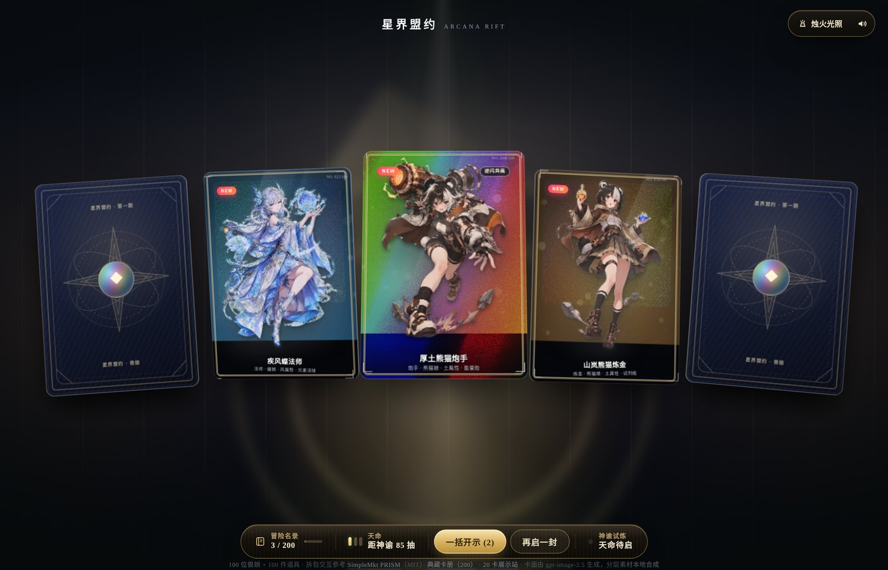

# Arcana Rift · 星界盟约

一个可以直接玩的全息抽卡收集站：**撕卡开包 → 逐张翻牌 → 200 件藏品图鉴**。

- 线上演示：https://gacha.lukezystudio.cn/
- 藏品图鉴：https://gacha.lukezystudio.cn/codex.html



## 玩法

- **一包 5 张**，100 位兽娘 + 100 件道具按稀有度权重混抽
- **五档稀有度**：N / R / SR / SSR / UR（`common / rare / holo / ultra / secret`）
- **必须先撕包**：按住封蜡横向扯开，才有光流喷涌和扇形发牌
- 图鉴按「角色 / 道具」分栏，未收录显示黑色剪影，最稀有两档只给 `?`
- 进度存在 `localStorage`，与图鉴页共用

## 技术要点

### 卡面是三层结构

每张卡由三张图叠出来，倾斜时产生视差纵深：

| 图层 | 文件 | 位移系数 | 内容 |
|---|---|---|---|
| 背景 | `img/card/<id>-bg.webp` | 0.07 | 场景 + 底部压暗 |
| 镭射 | CSS 伪层 | — | 彩虹扫光 |
| 角色 | `img/card/<id>-ch.webp` | 0.26 | 抠像角色（浮起） |
| 铭牌 | `img/card/<id>-plate.webp` | 0.30 | 底部渐变 + 角标 |

铭牌文字用 DOM 渲染，并通过 `--rz` 反向抵消卡片旋转，保证名字始终横向可读。

### 生成流水线（`pipeline/`）

```
gen_art.py      100 张兽娘立绘（hfsy gpt-image-2.5，绿幕）
gen_items.py    100 件道具立绘
process_assets.py / process_items.py   绿幕抠像 + 去星尘噪点 + 程序化背景
compose_cards.py   合成 640×854 图鉴用全幅卡面 + 生成 cards-config.js
compose_hd.py      合成 1080×1512 三层高清卡面（Lanczos 上采样 + USM 锐化）
gen_anim.py        用「参考图 + 文本」生成待机序列帧
```

绿幕抠像用 `excess = g - max(r,b)` 做色键，配合形态学与最大连通域；
道具额外做连通域去尘（`min_area=900`），否则物件周围会留一圈星点。

## 本地跑

```bash
pip install pillow numpy
# 站点是纯静态，直接起个静态服务器即可
cd site && python3 -m http.server 8000
```

卡面素材已随仓库提供；重新生成素材需要设置 `HFSY` 的 API key 放在 `~/.dsh/vision.env`。

## 许可

- 本项目代码：MIT
- 开包台交互移植自 [SimpleMkt PRISM](https://github.com/Lone3m-tech/prism-holo-pack)（MIT），见 `NOTICE.md`
- 美术素材全部由本项目生成

## 悬停序列帧动画（实验）

拿两张卡做了原型：**月影狼德鲁伊（001）** 与 **神谕之钥（P23）**。

鼠标悬停到卡片上时，静止的角色层淡出，换成 4 帧序列帧循环播放（上浮 / 飘动 / 光晕呼吸）。

### 怎么生成的

1. `pipeline/gen_anim.py` 走 hfsy 的**「参考图 + 文本」**出图，逐帧描述动作差异
   - 网关**不支持 base64 参考图**，只吃公网 URL，所以参考图放在 `site/anim/ref/`
   - 每帧约 120–340 秒，6 帧共约 12 分钟（3 并发）
2. `pipeline/process_anim.py` 把 4 帧（原图 + 3 张生成帧）对齐成一张 4320×1512 的雪碧图：
   - 绿幕抠像 → 取 alpha 包围盒 → 按高度缩放到基准 → 中心对齐
   - 每帧再叠一点垂直位移（0 / -20 / -32 / +10 px）保证上浮感和循环闭合
   - 最后按 82% 放大到 1080×1512 画布，和静态 `-ch` 完全同一套坐标
3. 前端用 `<i class="ca-anim"></i>` 叠在角色层上：

```css
.ca-anim img { width: 400%; height: 100%; }
.card.is-playing .ca-anim img {
  animation: caAnimPlay 1.4s steps(4, jump-none) infinite;
}
@keyframes caAnimPlay { to { transform: translate3d(-75%, 0, 0); } }
```

`steps(4, jump-none)` 是关键：普通的 `steps(4)` 只会停在 0/25/50/75% 的进度上，
最后一帧永远到不了，而且中间会出现半帧错位。

### 从「呼吸」升级成真正的动作

第一版只做了上浮呼吸，看起来不像动画。现在是 6 帧的姿态序列（挥手 / 道具摆动）：

| 帧 | 动作 |
|---|---|
| 1 | 原图（手自然下垂） |
| 2 | 抬手到胸前 |
| 3 | 举到肩高、掌心朝前 |
| 4 | 手腕向一侧偏 20° |
| 5 | 手腕向另一侧偏 20° |
| 6 | 收回胸前 |

播放时用 `alternate` 乒乓循环：`1→2→3→4→5→6→5→4→3→2→1`，
所以首尾天然衔接，不会出现跳帧。

对齐锚点用**头部**（头顶 y + 头部水平中心）而不是整体包围盒——挥手时手臂外扩会把包围盒撑大，
按包围盒对齐整个人会忽大忽小；再按全身高度统一缩放，保证每帧人一样大。

> 关于眨眼：这一版没做。用同一个出图通道生成「闭眼」帧时，模型会把头部角度重画成 3/4 侧脸，
> 和原图对不上，做成眼睛贴片会穿帮。真要做眨眼，需要把头部/眼睛拆成独立图层做伪 Live2D。

### 铭牌文字：从「贴纸」改成「烫金浮雕」

最早文字完全反向抵消卡片旋转，倾斜时像一张贴纸浮在卡面上。现在：

- **反向旋转只抵消 40%**，再 `translateZ(16px)` —— 文字跟着卡一起倾斜，但比卡面浮起一点，
  有真实的空间位移
- **四层 text-shadow 做浮雕**：1px 金色下缘（烫金凸起）+ 2px 暗边 + 近投影 + 远柔和投影，
  外加一圈暖色外发光
- 字号从 4.3cqw 提到 6.8cqw，文字块在铭牌带里**垂直居中**（之前是贴底，显得空）

---

# 移动版：店长玩法（`mobie` 分支）

参考 [B 站「闪卡物语 HOLO TALES」](https://www.bilibili.com/toy/holo-tales/index.html) 的完整流程，
把本项目从「一次性开包体验」改造成**竖屏卡牌小店经营**：

https://gacha.lukezystudio.cn/m/

## 参考实现的流程拆解

抓下来看，闪卡物语是 **Godot 4 导出的 WASM 游戏**（`index.js` 里 `var Godot=(()=>{`），
逻辑拿不到，所以按**实际交互**逐屏还原。它的结构是：

```
顶部   头像 · 昵称 · Lv · 经验条 | 金币 200 · 钻石 60 · 第三种代币
主页   免费卡包（已攒满 ×2，可随时间累积） / 任务（0/5）
       信箱（未读红点） / 陈列位（Lv8 Lv15 Lv25 解锁）
       今日活动（今日热门：光属性 · 回收价 +30%）/ 保底进度
开包   全屏黑底 + 卡包 +「滑动撕开」+ 自动/跳过
       撕开后 5 张卡依次翻开，NEW 角标
背包   网格 + 稀有度筛选 + 点开看详情
对战   卡组对战
交易   市场买卖（热门属性加价）
```

关键设计点：**第一次进入先取名**（"名字会写进你召唤的每张卡"），然后送 3 个新手包，
用「手指横着一划」把手势教学和开包动作合成一步。

## 现在的实现

`site/m/` —— 单页应用，原生 JS，复用现有 200 张卡面素材（`../img/card/*.webp`）。

| 模块 | 说明 |
|---|---|
| 存档 | `localStorage` 一份 JSON（资源/背包/任务/保底/热门），跨 tab 共用 |
| 主页 | 免费卡包倒计时（8 分钟 +1，上限 2）、任务、信箱、陈列位、今日热门、保底进度 |
| 开包 | 横向拖拽撕包（进度条 + 蓄力光晕），撕开掉落 5 张，NEW 角标 |
| 背包 | 三列网格 + 角色/道具/稀有度筛选 + 详情弹层（战力、参考价、回收价） |
| 回收 | 回收价 = 卡价 35%，热门属性 +30% |
| 交易 | 每日市场 6 件（日期做种子，当天稳定），热门加价 30%，用金币买入 |
| 对战 | 选 1～3 张出战，战力=稀有度基础值×热门加成，随机对手，胜负有金币与经验 |
| 任务 | 每日 5 个（开包/回收/对战/交易/出 SR+），可领取金币 |

稀有度经济：N 40 / R 90 / SR 200 / SSR 520 / UR 1400（回收 35%）。
保底：累计 30 抽未出 SSR/UR 必出秘宝。

## 分支

```bash
git checkout mobie
```

桌面版仍是 `index.html`（PRISM 撕卡开包台），移动版是 `/m/`，两者共用同一套卡面与 `cards-config.js`。

## 第二轮：游戏化 UI + 三消战斗

### 美术统一

所有 UI 素材都用 hfsy 生成，**以卡牌立绘为参考图**锁死画风（暗紫 + 鎏金 + 水墨），
绿幕出图后本地抠像：

| 素材 | 用途 |
|---|---|
| `icon_home/bag/pack/fight/trade` | 底部导航五个图标 |
| `icon_coin/gem/ticket` | 顶部三种货币 |
| `icon_mail/task/fire/lock` | 信箱、任务、今日热门、未解锁 |
| `gem_fire/water/wind/thunder/light/dark` | 三消棋子（菱形宝石） |
| `pack_front` | 开包页卡包正面 |

流程：`pipeline/gen_ui.py`（6 并发，参考图 + 绿幕）→ `pipeline/process_ui.py`（色键抠像、
连通域裁剪、统一尺寸输出 webp）。共 19 个素材，合计 496KB。

### 界面

- 竖屏约束：`body { max-width: 480px }`，宽屏下也是手机比例
- 面板统一 `.panel`：紫黑渐变 + 内阴影 + 金色角标（`::before/::after` 画 12px 折角线）
- 按钮 `.btn`：鎏金渐变 + 顶部高光 + 底部立体边 + 按下位移
- 底部导航：五个生成图标，中间开包按钮放大并加光晕

### 三消战斗

原对战（比大小）换成**竖屏三消**，规则移植自本机 `matchgame` 项目（8×N 棋盘 → 这里 7×7）：

- 六色宝石，交换相邻凑 3 消
- 伤害 = 消除数 ×（与卡组属性共鸣则 ×2）× 连击加成（每连 +30%）
- 玩家生命 = 60 + 卡组数 × 20；敌方 HP/攻击力由对手卡稀有度决定
- 每回合玩家交换一次，敌方反击一次
- 消除后塌落补充、无解自动重排
- 胜负结算金币与经验，写进试炼记录

`site/m/battle3.js` 是一个独立的战斗模块，`createBattle({host, deck, enemy, onEnd})`，
DOM 渲染 49 个格子 + CSS 动画，不依赖 canvas。

## 第三轮：抽卡保留全息镭射

移动版一开始把卡面拍平成一张合成图，镭射/眩光全丢了。现在恢复桌面版的层次结构：

```html
.mcard                    ← 3D 倾斜容器（--rx/--ry/--px/--py/--hyp）
  .mc-bg      背景层      ← 视差 0.07
  .mc-holo    镭射彩虹    ← color-dodge，随指针移动，倾斜越大越强
  .mc-glare   眩光        ← overlay，跟着指针走的白色径向高光
  .mc-ch      角色层      ← 视差 0.3，浮起
  .mc-plate   铭牌层      ← 视差 0.34
  .mc-text    铭牌文字    ← 反向旋转 40% + 烫金浮雕
  .mc-clear   清漆        ← 内圈高光 + 边缘反光
  .mc-sheen   常驻斜向光泽
  .mc-shine   镭射扫光    ← 4.6s 循环掠过的彩虹光带
```

**关键差异**：桌面版用 `filter: brightness(.74) contrast(1.48)` 压住彩虹；
移动端 3D 子树里不能加 `filter`（安卓会闪），所以改成**满饱和彩虹 + 低透明度**（N/R 0.13–0.55，
SR 0.18–0.64），效果等价且不会触发重绘抖动。

稀有度也做了区分：SSR 叠放射光束（`repeating-conic-gradient`），UR 叠双向星芒。
指针拖动 / 鼠标悬停时彩虹和眩光跟着走；松手回正。

## 第四轮：信息上卡 + 展示字体

原来卡面只有名字，类型/属性/战力/价格散落在弹层的列表里。现在全部收进卡片底部的**独立信息层**：

```
.mc-info            ← 独立图层，translateZ(12px)，反向旋转 40%
  .mc-name          名字：ZCOOL 庆科黄油体 + 5 层金色挤出错觉
  .mc-meta          SR 徽标 · 类型 · 属性
  .mi-row           战力 / 参考价 / 持有（大卡）
  .mi-foot          战 10 · 40⦿（列表小卡）
```

字体用 **ZCOOL 庆科黄油体**（SIL OFL），通过 Google Fonts 的 `text=` 参数只请求
卡名/标签/数字用到的 370 个字形，子集后 woff2 只有 **62KB**，直接自托管在 `site/fonts/`。

名字的立体感靠多层 `text-shadow` 做挤出：

```css
-webkit-text-stroke: 2.2px #3a2205;
paint-order: stroke fill;
text-shadow:
  0 1px 0 #f6cf7a, 0 2px 0 #e0ae4e, 0 3px 0 #c28f34,
  0 4px 0 #9d6f22, 0 5px 0 #7b5516,
  0 7px 10px rgba(0,0,0,.75), 0 0 16px rgba(255,205,120,.32);
```

配合 `-webkit-text-stroke` 深色描边，小字号也能立住。

## 第五轮：三消交互与战斗布局

### 布局：上战斗 / 下三消

按参考站的结构重排：上半是战斗舞台（敌方立绘 + 名字 + 红色血条，中间 `⚔`，
下面出战卡三张 + 绿色血条），下半是 7×7 棋盘。命中时舞台抖动 + 白光闪，
敌方倒下时立绘转灰。

### 交互：拖动 + 点选都支持

- **拖动**：按住宝石往任意方向拖过一格距离即交换（`touch-action: none` 防止浏览器抢手势）
- **点选**：点一颗 → 出现脉冲光环选中态，再点相邻一颗即交换
- 换不出三连会**弹回原位** + 抖动变红 + 提示，不再是「点了没反应」

### 真位移动画

棋盘从「每次重排 innerHTML」改成**绝对定位 + transform 位移**：

- 交换：两块同时滑到对方位置（170ms）
- 消除：`gemPop` 放大闪光后缩小消失（220ms）
- 塌落：上方宝石平滑下落，新宝石从棋盘顶部外滑入
- 无解时原地重排并刷新每格图样

这样每一帧都是连续的位移，而不是瞬间跳变。
